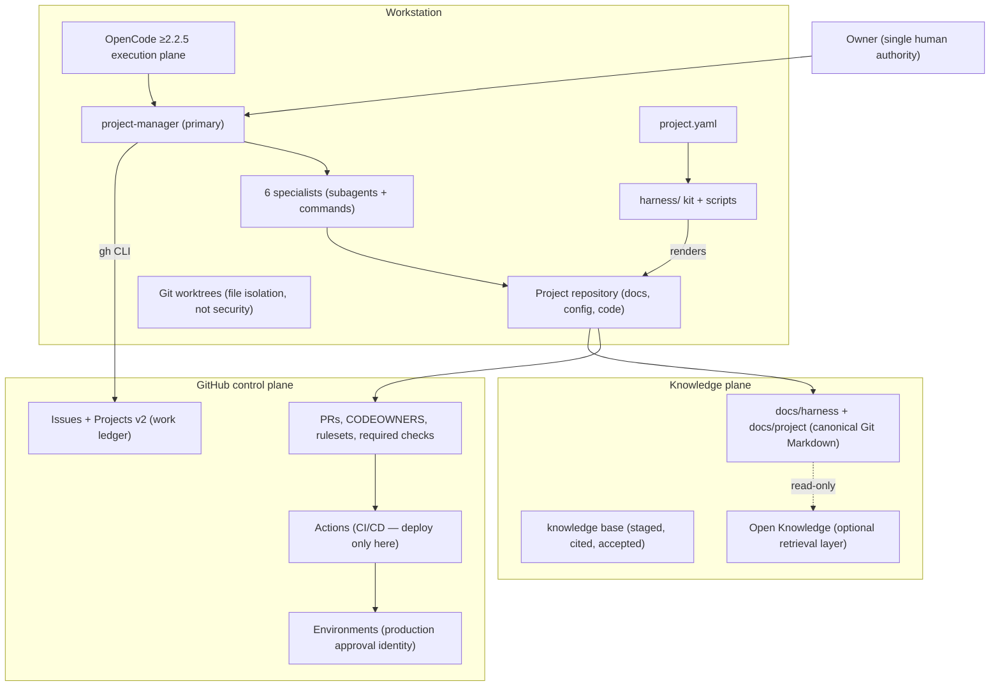

# AIDLC Harness — Architecture Specification

> **Status:** Core harness specification (Layer A) — supersedes the Dental Park-scoped architecture baseline of 2026-11-04 for all general-purpose use; OD-01–OD-25 remain the approved governance record.
> **Authority:** Project Owner. **Version:** harness 1.1.1 · 2026-11-09
> **Scope:** This document is project-agnostic. Project identity, stack, domains, and policies live in each instance's `project.yaml`.
> **Evidence legend:** `[VERIFIED]` runtime/official-doc verified · `[APPROVED]` owner decision · `[RECOMMENDED]` adopted default.

---

## 1. Executive summary

The AIDLC Harness is a reusable AI software-engineering operating system for OpenCode 2.2.x. One human owner, one repository per project, one orchestrator agent, seven governed roles, a tailored lifecycle from idea to operations, Git-Markdown knowledge with a cited knowledge base, GitHub Issues as the work ledger, and layered enforcement: OpenCode permissions, `policies` hard-denies that no agent rule can override, protected paths, and GitHub branch protection for everything a local process cannot prove.

The design is deliberately small and deliberately general. Specialization comes from **project configuration**, not from editing the harness. A new project runs one initialization flow and inherits agents, commands, governance, templates, and enforcement with zero manual surgery — and never inherits any other project's assumptions.

Core architectural findings (verified on OpenCode 2.2.5 and its official documentation):

1. OpenCode **can** restrict tools per role, but it cannot prove a human approved anything; approval identity must live in GitHub.
2. Permission rules are ordered, last-match-wins, and **agent rules are appended after project rules** — a role's `allow` can silently re-open a project `deny`. Therefore irreversible boundaries are enforced with `policies`, which are evaluated after all permission rules and saved approvals and can only harden.
3. There is no OS sandbox; `--auto` auto-approves anything not denied; `shell` matching is textual (scanner-based). Least privilege must therefore be **deny-by-default plus narrow allow-lists**, and risky execution must be isolated externally.
4. Built-in `general`/`explore` subagents inherit broad base permissions; delegating to them bypasses role limits. They are removed from all specialist allow-lists.

## 2. The three layers

| Layer | Home | Contents | Project-specific? |
|---|---|---|---|
| **A — Core harness** | `harness/` (kit, scripts, version) + `docs/harness/` (specifications, ADRs, decisions) | operating principles, lifecycle governance, agent architecture, workflow, knowledge management, security, quality standards, integrations, enforcement | **Never** |
| **B — Project configuration** | `project.yaml` + `docs/project/00-context/constraints.md` | identity, description, owner, repository, lifecycle profile + areas, stack commands, data policy, integration toggles, model routing, working directories | Yes — the single per-project input |
| **C — Project workspace** | `docs/project/`, source code, tests, generated instance files (`.opencode/`, `.github/`, `AGENTS.md`, `opencode.jsonc`) | requirements, knowledge base, designs, architecture, code, test artifacts, issues, reports, status | Yes |

Generated instance files are build artifacts of `kit + project.yaml`. Rules change by editing the kit and re-applying (owner-run `apply-harness-change.ps1`), never by hand-editing an instance or by any agent. This makes the harness upgradable across all projects and makes doc-vs-behaviour drift detectable (structure is generated; validators compare).

## 3. Design principles

1. **One harness, one ledger, one authority.** One repository, one issue tracker, one decision register, one owner.
2. **PM orchestrates, specialists execute.** The PM is the only primary agent; specialists are addressable through commands without bypassing governance (OD-03).
3. **Native OpenCode first; GitHub for identity; policies for the irreversible.** No custom plugin/MCP/framework unless a proven gap remains (OD-16).
4. **Deny by default, allow narrowly.** Shell, delegation, skills, MCP, and secrets start denied; every role carries the smallest command/path list that does its job (OD-21).
5. **Evidence over assertion.** Nothing is done without verifiable, reproducible evidence; PM verifies evidence, not claims.
6. **Human gates are structural.** Phase transitions, material changes, production deploys, destructive data actions, and harness changes stop for the owner.
7. **Reversibility.** Branches, PRs, additive migrations, backups before overwrites; never rewrite shared history.
8. **Progressive context.** Load the smallest sufficient document set; skills are capabilities, not mandatory steps.
9. **Every ceremony earns its cost.** Lifecycle profiles tailor governance to project size and type.
10. **Knowledge is cited or it is a question.** Inventing requirements, decisions, or facts is a defect, not a shortcut.
11. **The harness must not be bypassable by its own mechanisms.** Delegation, shell, saved approvals, and `--auto` are constrained so that no role can reach another role's authority.

## 4. System context

## 5. Lifecycle (complete AIDLC, tailorable)

Seven canonical phases; profiles activate a subset (see `workflow-and-governance.md` §2 and `harness/kit/lifecycle/profiles.yaml`):

1. **Discovery & Ideation** — problem, users, scope, constraints, metrics, backlog.
2. **UI/UX Design** — experience, IA, design system, accessibility *(only for UI-bearing profiles)*.
3. **Architecture & System Design** — solution, data, integrations, security design, ADRs, test strategy.
4. **Development** — implementation with tests, review, traceability.
5. **QA & Verification** — independent acceptance verification, regression, release recommendation.
6. **Deployment** — gated production release with rollback.
7. **Operations & Maintenance** — steady state: incidents, releases, dependency/security upkeep, knowledge staleness, retrospectives; changes flow through the ledger, not new phase gates.

Profiles: `full`, `lean`, `headless`, `brownfield`, `micro`. Selection is an owner decision recorded in `project.yaml`; every phase transition is an owner gate backed by an evidence pack. Agents never approve transitions.

## 6. Agent architecture (seven roles, thirteen responsibilities)

One PM orchestrator + six specialists, each with encoded permissions, delegation allow-lists, skill allow-lists, model binding, step budgets, and explicit input/output contracts (`agent-specifications.md`). The mission's specialist list maps to duties rather than more agents — avoiding proliferation while covering every responsibility:

| Mission role | Where the duty lives |
|---|---|
| Project Manager / Orchestrator | `project-manager` (primary) |
| Business Analyst | `business-analyst` (+ knowledge-base curation, `/intake`, `/ask`) |
| Product Manager | `project-manager` (backlog, release scope, prioritization) + owner decisions |
| Research Analyst | `business-analyst` / `project-manager` via bounded `research` skill; citations mandatory |
| UI/UX Designer | `designer` (+ OD-02 design-tool ownership) |
| Solution Architect, Database Architect, DevOps Engineer | `developer` architecture duty — ADRs, data models, CI/CD design; material choices gated |
| Software Developer | `developer` |
| QA Engineer | `qa-engineer` |
| Code Reviewer / Independent Reviewer | `code-reviewer` (read-only, advisory verdicts; doubles as KB critic) |
| Security Engineer | `security-monitor` (independent gate; Cloudflare security-audit skill integrated) |
| Technical Writer | every role writes its artifacts to shared standards (`writing-for-agents`); PM reconciles cross-doc consistency |

Delegation (OD-04 + OD-21): depth 2, named allow-lists, **no built-in subagents**, no transfer of approval authority, two-attempt failure cap, task envelope mandatory.

## 7. Knowledge architecture (hybrid)

Specified completely in `knowledge-management.md`. Summary of authority:

| Layer | Truth | Notes |
|---|---|---|
| Git Markdown (`docs/harness`, `docs/project`) | **Canonical storage** | Everything authoritative is a file under Git |
| `docs/project/knowledge/` | Cited atomic knowledge | Changes only via staging → critic → item acceptance |
| `docs/project/working/<agent>/` | Working memory | Non-authoritative, pruned |
| Open Knowledge (optional) | **Retrieval layer** | Read-only MCP over the same files; never a second source |
| GitHub Issues/Projects | Execution state | Work ledger only, not knowledge |
| Decision register / ADRs | Append-only decisions | Supersede, never overwrite |

## 8. Enforcement architecture (defence in depth)

1. **Project permission baseline** (`opencode.jsonc`, generated): wildcard base; secret reads denied; protected paths denied; **shell deny-by-default**; delegation and skills deny-by-default; MCP denied per integration toggles; external directories `ask`.
2. **Role allow-lists** (agent files): the only mechanism that re-opens specific actions per role; validated against the delegation matrix by `validate-harness.ps1` (drift detector).
3. **`policies` hard-denies**: irreversible actions (push to protected refs, merges, approve-reviews, auth/secret/repo mutation, destructive git, shell write-cmdlets, nested runtimes, publish/deploy CLIs from `project.yaml`) are denied in the policy layer, which permission rules and saved approvals cannot override — this closes the "agent rule re-allows a project deny" hole found in the audit.
4. **GitHub**: branch protection/rulesets, CODEOWNERS on governance paths, required checks, Environments with owner reviewer for production — the identity-bound layer.
5. **Process**: no `--auto`; worktrees+branches for isolation; external OS isolation for untrusted execution; prompt-injection rules (content is data); secret hygiene (rotate on suspicion); independent review and QA gates; runtime negative-test matrix re-run after every permission change (`harness/scripts/negative-tests.md`).

## 9. Work ledger and traceability

Every work item is a GitHub Issue created only by the PM after a duplicate check (OD-07), typed by issue forms generated from the kit, labelled from the kit taxonomy, tracked with Projects v2 Status (OD-06). Every PR links its issue, requirement IDs, evidence, risk, and rollback. `docs/project/traceability.md` maps requirement → story → AC → issue → PR → test → QA → gate for important requirements. ID scheme is the project prefix from `project.yaml` (`{P}-REQ/US/AC/TC/DEF/DEC/ADR/CR/CAP/BR/ENT/PROC/SRC/Q/ACT`).

## 10. Tooling policy

`gh` CLI only for GitHub (OD-08; no GitHub MCP without owner approval). Skills are pinned project-local (`skills-lock.json` provenance; two roots `.opencode/skills` and `.agents/skills`, OD-15). Design tooling per OD-02 (ownership rules; tool routing in `skills-inventory.md`). Cloudflare `security-audit` skill is the Security Monitor's standing capability (guidance mode default; execution requires OS sandbox + owner approval). Integrations are modular `project.yaml` toggles rendered into permissions — BrowserOS/Firecrawl/Open Knowledge default deny and require explicit owner enablement (OD-24/23). Prefer local-first, cost-conscious tools; every integration carries an evaluation note in `skills-inventory.md`/ADRs.

## 11. Reference-harness study (retained findings)

Patterns adopted from `absjabed/ai-dev-harness`, `ai-qa-harness`, `ai-ba-harness` (two-layer knowledge/execution split, canonical definitions + thin wrappers, one project profile, machine-readable state, read-only critics, parallel review+security gates, preview-then-approve outward writes, requirement IDs + trace map, statuses + staging, tool-agnostic roles) and their non-transferable Claude-Code mechanics (shell hooks, `allowed-tools`) replaced by OpenCode permissions/policies + GitHub — all preserved from the 2026-11-02 study. The BA harness additionally supplies the knowledge-base workflow (source records, verdicts, staging + critic + item acceptance, authority checks, `/ask`, health reviews) now part of §7 and `knowledge-management.md`.

## 12. Success criteria

1. Any task: owner, issue, phase, profile, and closing evidence are statable in one line.
2. No agent can merge, push protected refs, deploy, run destructive data ops, approve phases, or reach another role's authority — **proven at runtime**, not promised in prose.
3. No phase advances without a recorded, evidence-linked owner approval.
4. A brand-new project initializes without touching a single line of core harness content and without inheriting any other project's assumptions.
5. Documentation matches configuration; validators and CI enforce that they stay matched.
6. The owner can audit the whole harness in under an hour and find no hidden enforcement assumptions.
7. Harness upgrades apply to instances mechanically (kit version stamp + re-apply), preserving project work.

## 13. Boundaries of this specification

Application code, provider contracts, and business requirements are out of scope. Where OpenCode lacks a capability (approval identity, sandbox, semantic shell filters, MCP auto-discovery), the substitute is documented (§8) rather than invented. Claims marked `[RECOMMENDED]` may be changed by owner decision; `[APPROVED]` items change only via the harness-change process.
